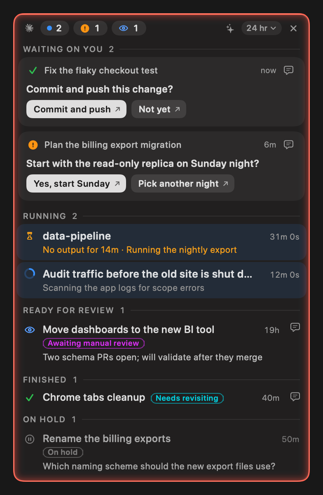
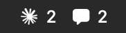
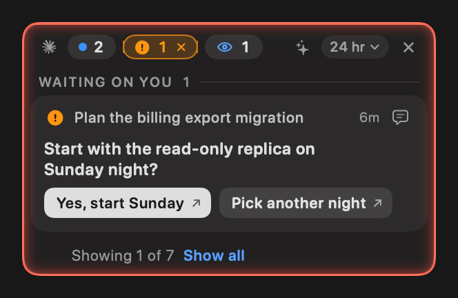
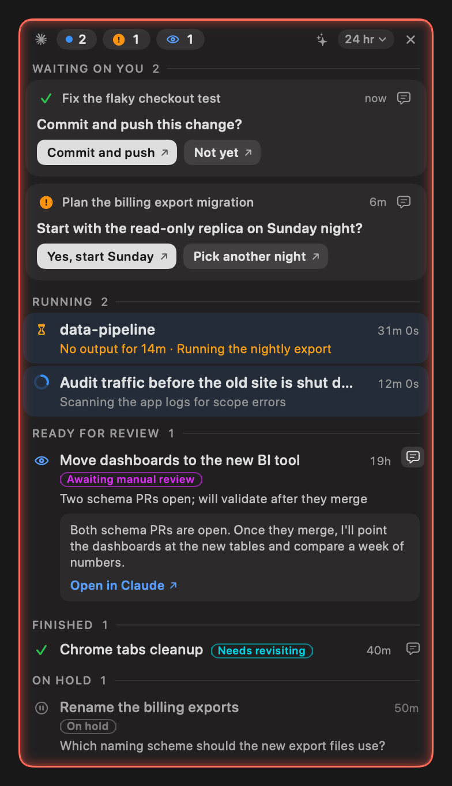
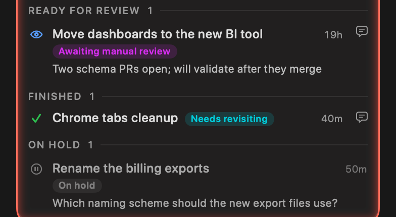
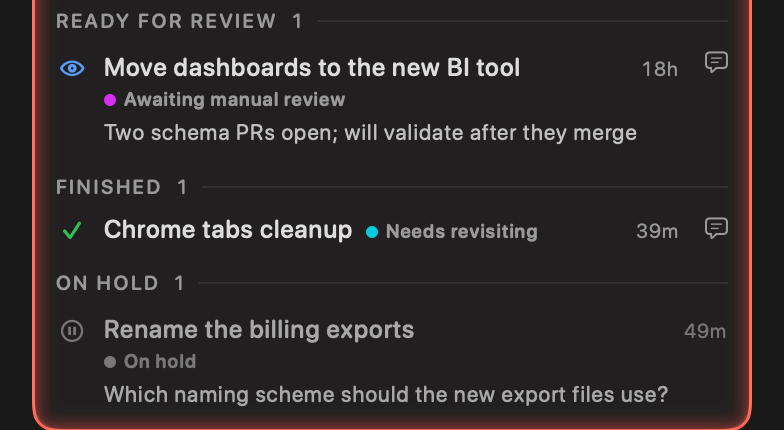
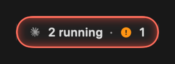
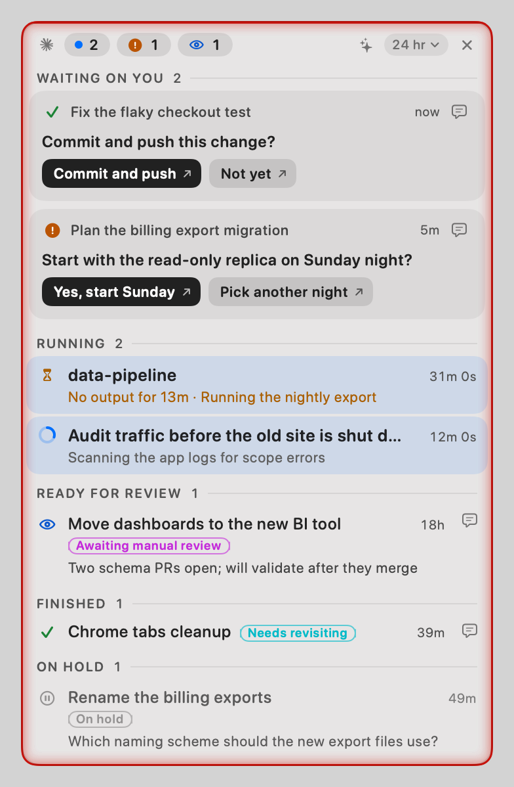

# Limbo

macOS menu-bar board for Cursor, Claude, Grok, and Codex sessions.

A local Go watcher reads verified Mac signals and writes a JSON snapshot. The tray reads that file. No webhooks. No HTTP. No secrets in logs or files.

The watcher binary is still `session-watcher`.

## Build

```bash
make build
# → bin/session-watcher  (darwin/arm64)
```

Or:

```bash
GOOS=darwin GOARCH=arm64 go build -o bin/session-watcher ./cmd/session-watcher
```

## Test

```bash
make test
# or: go test ./...
```

Tests inject fixture paths and process listings — they never hit a real home directory.

## Run

```bash
# single snapshot
./bin/session-watcher once

# poll every 5s (default); override with -interval
./bin/session-watcher watch
./bin/session-watcher watch -interval 2s
```

### Outputs

**1. Transition log** (`events.jsonl`) — one JSON line per `(tool,label)` state change, also printed to stdout:

```json
{"tool":"cursor","label":"Cursor","state":"idle","ts":"2026-09-16T10:00:00Z","source":"session-watcher"}
```

| Field | Values |
|-------|--------|
| `tool` | `cursor` \| `claude` \| `grok` \| `codex` |
| `label` | Tool-specific (see signals docs) |
| `state` | `running` \| `idle` \| `finished` |
| `ts` | RFC3339 UTC |
| `source` | `session-watcher` |

**Log path:** `~/Library/Logs/session-watcher/events.jsonl`  
Fallbacks: `$SESSION_WATCHER_LOG`, or `./events.jsonl` if `~/Library` is missing.

**2. Tray snapshot** (`state.json`) — rewritten atomically on every `once` / watch tick with the **current live set only** (no finished rows):

```json
{"updated":"2026-09-16T10:00:00Z","sessions":[{"tool":"cursor","label":"Cursor","state":"idle","ts":"2026-09-16T10:00:00Z"}]}
```

**State path:** `~/Library/Application Support/session-watcher/state.json`  
Fallbacks: `$SESSION_WATCHER_STATE`, or `./state.json` if `~/Library` is missing.

The tray app should read `state.json` (not scrape processes itself).

Dedup: emits only when `(tool, label)` state changes; disappeared → `finished` in the event log.

## Limbo Tasks (Claude sessions, grouped by what they need from you)

A small, separate menu bar app in [tasks/main.swift](tasks/main.swift) that shows every Claude Code session in the Claude desktop app: what is running, what is waiting for you, what is ready for review and what just finished. It does not need the Go watcher. All screenshots below use the app's built-in sample sessions (`--sample`).

<p align="center"></p>

```bash
make install-tasks     # build, install ~/Applications/Limbo Tasks.app, start at login, start now
make uninstall-tasks   # remove the app and the login item
make tasks             # build only -> bin/limbo-tasks
```

A stable signing identity keeps macOS's Accessibility permission (used by Answer from Cards) across rebuilds: put `SIGN = <certificate SHA-1>` in `local.mk`, which git ignores. Without it the app is signed ad hoc and macOS forgets the permission after every rebuild.

### Features

| | |
|---|---|
| **Menu bar** | The Claude mark with the number of sessions running and a speech bubble with the number waiting for you. |
| **Menu bar panel** | Every session from the last 7 days in groups: Running, Your turn, Just finished, Ready for review, On hold, Done, In a terminal. |
| **Keep-on-top window** | A small window above everything, full-screen apps included, that never takes the keyboard. |
| **Waiting on you cards** | A session's question and the buttons from Claude's next-step box, with its latest reply one click away. |
| **Answer from Cards** | Click a card's button and Limbo presses it in Claude for you, then puts your screens back. |
| **Tags** | On hold, Awaiting manual review, or your own; four tag styles. |
| **Glows** | A calm rim while sessions run, amber when one needs you, green when everything finishes. |
| **Pill** | The window shrunk to just its counts. |

#### Menu bar



The Claude mark with the number of sessions running, then a speech bubble with the number waiting for you (last 3 days); a check mark when neither. While sessions run, the mark turns once every 3 s (it holds still with Reduce Motion on and stops while the screens sleep). The mark is taken at run time from the installed Claude app's own menu bar icon, so nothing of Claude's is copied into this repo. Click it for the panel.

#### Menu bar panel


Every session from the last 7 days, grouped by what it needs from you (the rules are under [Session states](#session-states)). Each row shows the session, what it is doing or asking, its folder (or the session that started it) and how long ago. Click a row to open it in Claude; the pin button opens the keep-on-top window. Done, In a terminal, On hold and questions older than 3 days fold away; Start at login and Quit are at the bottom.

#### Keep-on-top window

The pin in the panel opens a small window with the running sessions, the ones waiting for you or ready for review, and ones finished in the last 2 hours. It stays above other windows, full-screen videos and games included, on every Space, and never takes keyboard focus, so it never interrupts what you type.

- **Sections:** small capital headings with a count and a hairline: Waiting on you, Running, Needs you, Ready for review, Finished, On hold.
- **Look:** Apple's rounded system font, 16-point corners, a light blue backing behind running sessions, stronger titles for sessions still going, one line per finished session.
- **A mark per state,** told apart by shape as well as colour: a turning blue ring (running), an hourglass (running but nothing written for 10 minutes), an exclamation (needs you), an eye (ready for review), a check (finished), a pause mark (on hold). Every time uses one short style: "4m 12s" ticking for running sessions, "6m", "18h", "now" for the rest.
- **Running sessions** show what they are doing now, like Claude's own status line ("Thinking", the command being run, the file being edited), with a light band sweeping across it. A session between turns that still has background tasks running shows "2 background tasks running" and counts as running.
- **Questions and summaries** show in full, wrapping onto more lines; a running status stays on one line so the row doesn't jump.
- **Count chips filter the list:** click "1 needs you" to list only those sessions, click again for everything.

<p></p>

- **Time range:** the "24 hr" menu sets how far back it shows sessions waiting for you (1 hour, 4 hours, 24 hours, 3 days, 7 days). Running sessions always show.
- **Size and place:** drag it by its header; resize it from any edge or corner (the resize cursor shows near the border). The position and size are remembered. Right-click the header for Fit to Content and Default Size.

#### Waiting on you cards and replies

When a session's latest turn ended with a question in Claude's next-step box (the box under its last message, with its buttons), the window shows it as a card at the top: the session, the question and the same buttons. Up to 3 cards show, newest first. By default each button opens that session in Claude, where you answer. A question goes away once you send anything to that session.

Rows and cards with a reply have a speech-bubble button: it shows the session's latest reply in place, with Open in Claude for the rest.

<p></p>

#### Answer from Cards

Turn it on from the window header's right-click menu (it asks for the Accessibility permission). A card's buttons then answer for you: Limbo presses the same button in Claude.

- **Exact matches only:** it presses only when the question on screen matches the card word for word, the button right after it has exactly that label, Claude shows that exact session, and the button holds still for a moment. On any doubt it presses nothing, opens the session in Claude and says why on the card.
- **Confirmed:** an answer counts as sent only when the transcript gains your message or the box's buttons go away; it presses once more only when the transcript shows nothing arrived, so it never answers twice.
- **In the background when it can:** if Claude already shows that session somewhere on screen, the press happens and nothing moves. Otherwise Claude comes forward for about a second or two (it ignores presses while its window is hidden), and then the window you were in comes back, along with any display that Claude's full-screen Space took over.
- **Fast:** Limbo starts reading Claude's window when the pointer reaches a card, so it is ready by the click. Measured with Claude hidden: the press landed 1.7 to 2 seconds after the click, Claude's own switch included. With Claude already showing the session there is no switch, so it should take about half a second.

#### Tags

Right-click any session (in the window, the panel or on a card) to tag it: **On hold**, **Awaiting manual review**, or your own with **New Tag…** (up to 30 characters). **Remove Tags** clears them.

- **On hold** moves the session to its own On hold section, dimmed with a pause mark. It no longer counts as needing you or ready for review, in the header or the menu bar, and never starts a glow. A running session on hold still shows as running and goes on hold when it stops.
- **Other tags** are labels: under the title, or beside it on a finished row when the whole title fits.
- **Tag style** (right-click the window's header): Outline (default), Filled, Dot and label, or Coloured text.

<table>
<tr><td><b>Outline</b><br></td><td><b>Filled</b><br></td></tr>
<tr><td><b>Dot and label</b><br></td><td><b>Coloured text</b><br></td></tr>
</table>

Tags stay until you remove them or archive the session in Claude. They live in Limbo's own settings, so they show only in Limbo; sessions started in a terminal can't be tagged. Typing a new tag opens a small box by the pointer, the one time Limbo takes the keyboard, and the app you were in gets it back on Return or Esc.

#### Glows

The window's edge tells you the state from the corner of your eye. The sparkle menu in its header picks the effect and colour.

<table>
<tr><td><b>Needs you</b><br></td><td><b>All finished</b><br></td></tr>
<tr><td><b>Aurora drift</b> (one of the other effects)<br></td><td><b>Pill</b><br></td></tr>
</table>

- **Calm rim** (default, shown at the top): while a session runs, a thin ring and a top edge in the glow colour breathe slowly, on a solid background with nothing behind the text.
- **Needs you:** while a session that started waiting for you in the last hour has not been opened (from Limbo or in Claude), the rim turns amber. A Got it button stops it without opening anything.
- **All finished:** when the last running session stops, the rim turns green until a session runs again or you open one. The green "All finished" chip in the header is its Got it.
- **Other effects:** Aurora drift, Ember breath, Corner bloom, Tide sweep, Rising warmth, Heartbeat, Random (a new one every 5 seconds) or No glow, in red, orange, rose or green. A new choice plays for 4 seconds so you can see it. The amber and green signals each have an on/off switch in the same menu.
- **Pill:** double-click the header's empty middle (or right-click it, Shrink to Pill) to shrink the window to just its counts and glow; double-click the pill to expand it.

#### Light mode and accessibility



In light mode the glow colours are deepened and the greys darkened so they pass contrast. With Increase Contrast on, the glow becomes a steady 2-point ring, borders turn solid and text gets bolder. With Reduce Motion on, the ring, the status band and every glow hold still. With Reduce Transparency on, the window has a solid background. Rows and buttons have VoiceOver labels.

### How it works

#### Session states

Panel groups, first rule that matches wins:

| Group | Rule |
|---|---|
| Running | The session's live process says `busy` (`~/.claude/sessions/<pid>.json`), or it is between turns with background tasks still running. |
| Your turn | The Claude app's own end-of-turn summary (`postTurnSummary` in the session's `local_<id>.json`) is current and says `blocked`, `need_input` or `failed`, or the session stopped with an error in the last 7 days. The row shows what it needs from you. Questions older than 3 days fold under "older"; older than 7 days drop off. |
| Just finished | The turn has ended but the app has not written its summary yet (usually seconds). |
| Ready for review | The summary says `review_ready`, and you have not opened the session in Claude since its turn ended (the record's `lastFocusedAt`, which Claude sets each time the session comes into view). Once you have, it counts as done. A session that finishes while you are already looking at it stays here until it next comes into view. |
| On hold | You tagged it On hold (and it is not running). |
| Done | Anything else from the last 7 days, collapsed. |
| In a terminal | Idle sessions started in a terminal. They have no summary, so they never count as your turn. Collapsed. |

Archived sessions are hidden. Clicking a row opens it in the Claude app (`claude://claude.ai/epitaxy/<id>`); terminal sessions can't be opened from here. **Not detectable:** a permission prompt in the middle of a turn. No file on disk records it, so that session shows as Running.

#### What it reads

- `~/.claude/sessions/<pid>.json`: the live Claude Code processes.
- `~/Library/Application Support/Claude/claude-code-sessions/<account>/<org>/local_<id>.json`: each desktop session's record, decoded into a few named fields (title, folder, turn times, end-of-turn summary, `lastFocusedAt`); the rest of the file is never kept. `waiting-input/` (queued input under the same file names) is skipped by path.
- The last 256 KB of each recent session's transcript (`~/.claude/projects/<folder>/<id>.jsonl`), only while the panel or the window is showing: what a running session is doing now, how its latest turn ended (the next-step box's question and buttons) and its latest reply. Re-read at most once a second while a session runs, and otherwise only when that transcript changes.
- Background tasks: the open files of the session's own child shells (via `libproc`), counting paths ending `.output` under `<session>/tasks/`. File names only, never contents.
- A running session that has written nothing for 10 minutes (its transcript, its agents' transcripts under `<session>/subagents`, its workflow files under `<session>/workflows`) gets the hourglass and "No output for 12 min": it may be stuck, or in one long command.
- It never opens the `*.key` files, and never changes Claude's files.

Limbo's own settings (tags, glow, tag style, window size and place, time range) are in its defaults domain, `com.maheshauti.limbo-tasks`; tags are kept by session id under `sessionTags`.

#### Answer from Cards, step by step

1. Limbo turns on Claude's accessibility tree (Chromium builds it only when asked) from when the pointer reaches a card until 12 seconds after the last answer, and turns it off again at quit.
2. On a click it notes the app and window you were in and what each display shows.
3. If Claude shows that session and some of its window is on screen, it presses there. Otherwise it opens the session through its link (which brings Claude forward) and waits until Claude has been in front for a second, since Claude ignores a press made sooner after switching.
4. It finds the newest copy of the question that has the button right after it, waits until that button stays the same element (a tenth of a second when Claude already showed the session), and presses it.
5. It checks the transcript every 0.1 s for your message (or the buttons going away). Nothing in 1.5 s and the button still there: one more press.
6. It raises the window that was in front on any display Claude's full-screen Space took over (macOS then slides that display back), then the window you were in, through Accessibility, and checks that your app is in front. If you were reading another session in Claude, Claude goes back to it.

The steps of the last answer, with the time of each since the click and no message text, are in `~/Library/Caches/com.maheshauti.limbo-tasks.answer.log`. The current-Space and window-number calls are private and read through `dlsym`; without them the displays are left as they are.

#### Keyboard focus and the cursor

The window is a non-activating panel that can never become the key window, so it never takes the keyboard from a game or a video. macOS shows cursor changes only from the frontmost app, which this window never makes Limbo; the resize cursors still show because, while the pointer is on an edge, Limbo turns on the window server's private `SetsCursorInBackground` setting, and turns it off again (after putting the arrow back) when the pointer leaves. The New Tag box is a separate panel that can take the keyboard without making Limbo the app in front.

#### Cost

- **No polling.** One FSEvents stream wakes the app when a session file changes, and only changed files are re-read, on a utility-priority queue.
- **Animations run in the window server.** The menu bar mark, the running ring, the status band and every glow are Core Animation layers animated at 15-30 fps, so the app does no work per frame. A profile with Aurora running found its main thread busy in 15 of about 7,000 samples, all of it the once-a-second stopwatch.
- **Measured:** 0.2 s of CPU at launch with 55 session records; 18 MB before the panel is first opened, 28-31 MB after (one panel is kept and reused; building a new panel per open leaked about 8 MB each time). With the window showing and two sessions running: about 0.2% of a core and 27-30 MB; with it hidden, 0%. Random switching every 5 seconds used 7 ms of CPU in 17 s. WindowServer's own CPU swings too much with screen content to pin any change on the window.
- Games that take over the display in exclusive full-screen mode can still cover the window.

#### Checks without the screen

```bash
limbo-tasks --dump                                  # group, age and title per row, plus counts
limbo-tasks --snapshot out.png [--dark] [--sample] [--expand] [--rows N]
limbo-tasks --snapshot out.png --floating [--glow calm|aurora|ember|corners|tide|rise|heartbeat] [--tint red|orange|rose|green] [--phase 1.5]
limbo-tasks --snapshot out.png --floating --attention | --flash | --done [--phase 0.7]   # amber, green flash, all finished
limbo-tasks --snapshot out.png --floating --size 440x260 | 440xauto              # the keep-on-top window at a size
limbo-tasks --snapshot out.png --floating [--mini] [--filter running|needsYou|review] [--contrast] [--solid]
limbo-tasks --snapshot out.png --floating --response local_s7 [--live] [-tagStyle outline|filled|dot|text]
limbo-tasks --glow-cycle 16                         # Random in an offscreen window: effect each second, then CPU used
limbo-tasks --gesture-check                         # chips, cards, replies, the New Tag box, close, pill (off screen)
limbo-tasks --resize-check                          # dragging the edges, and never becoming the front app
limbo-tasks --self-test                             # states, tags, glow decisions, cards, answers, background tasks
limbo-tasks --bench-panel 20 [--fresh] [--real]     # memory across panel open/close cycles
kill -USR1 $(pgrep -x limbo-tasks)                  # counts only -> ~/Library/Caches/com.maheshauti.limbo-tasks.stats.json,
                                                    # a picture of the menu bar button -> ...limbo-tasks.menubar.png,
                                                    # and the glow's state (effect, active, animating, size) -> ...limbo-tasks.glow.json
```

The screenshots in this README are made with `--snapshot … --sample`; `-tagStyle` and `-runningGlow` set those settings for one run.

## Signals

See [docs/signals.md](docs/signals.md) and [VERIFIED_SIGNALS.md](VERIFIED_SIGNALS.md).

## LaunchAgent (optional)

Example plist: [deploy/com.maheshauti.session-watcher.plist](deploy/com.maheshauti.session-watcher.plist) (commented; install manually on the Mac).

## Module

`github.com/maheshauti/session-watcher`
